<h2>“Tyger! Tyger!”</h2>

Curious about almost everything. I enjoy understanding how things work, noticing the details, and solving the problems in between.

<strong>Computer Systems Engineering</strong> · Always learning · Always questioning

When I'm not figuring something out: Rocket League, Attack on Titan, Hunter × Hunter, and a little Patrick Jane-level observation.

<h3>Find me elsewhere</h3>

Look closer. There's always more to the story.

